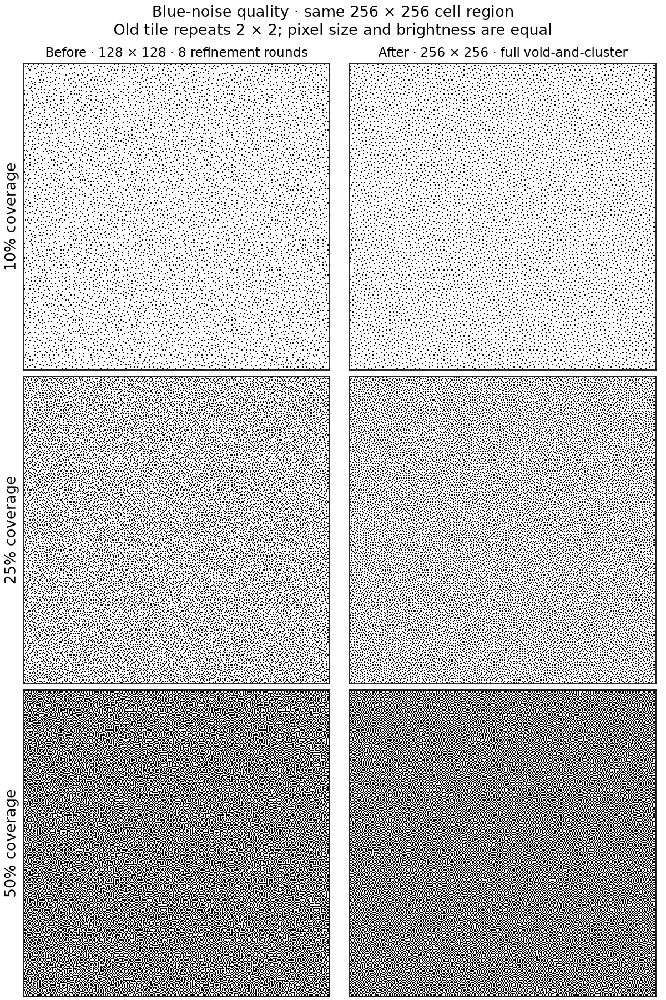
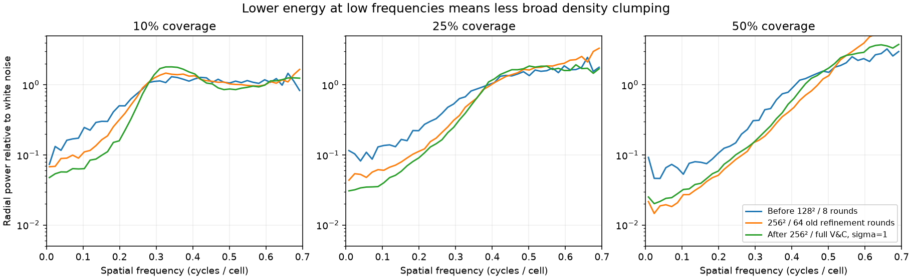

# Larger, better blue-noise tiles

The homepage now uses a true **256×256** blue-noise tile: 65,536 independently
ranked cells, four times the area of the earlier 128×128 tile. At the existing
2 CSS pixel dot size, the repeat period grows from 256 to 512 CSS pixels.
The simulation, shader rendering, colors, and animation timing are unchanged.

## Generation quality

The original generator used eight refinement rounds at each of 63 selected
thresholds. Increasing that to 64 rounds helped, but did not optimize the ranks
between those thresholds directly. The new offline generator uses a full
progressive [void-and-cluster algorithm](https://cv.ulichney.com/papers/1993-void-cluster.pdf).
It relaxes a seeded 10% binary slice until no cluster-to-void move improves it,
then progressively assigns every rank through sparse, midtone, and inverse
minority patterns. The 256² tile takes approximately two seconds to generate on
this Mac, including 2,804 initial relaxation swaps and 65,536 rank assignments.
`bun run build` in the source package regenerates all three shipped tile sizes.
The browser only decodes the result.

I compared Gaussian widths of 1.0, 1.1, 1.25, and 1.5. Wider filters suppressed
broad mottling more strongly but also produced more adjacent pixels in midtones.
σ=1.0 gave the desired balance: more isolated dots and less broad density
clumping. This is within the range examined in
[Ulichney's filter study](https://cv.ulichney.com/papers/1994-filter-design.pdf).
Gaussian energies use fixed-point integers to avoid accumulated rounding drift.
All boundaries wrap on both axes, so refinement also covers tile seams.

Measured on equal cell-size binary threshold slices, using the default seed:

| Coverage | Old low-frequency power | New low-frequency power | Reduction | Adjacent-pair reduction |
| -------- | ----------------------: | ----------------------: | --------: | ----------------------: |
| 10%      |                  0.1520 |                  0.0588 |       61% |       Both already zero |
| 25%      |                  0.0953 |                  0.0341 |       64% |                     70% |
| 50%      |                  0.0619 |                  0.0233 |       62% |                     17% |

Low-frequency power is the mean Fourier power within 0–0.08 cycles/cell,
normalized to white-noise variance; DC is excluded. It measures broad density
variation, not a percentage of visual quality. Adjacent pairs count horizontal
and vertical minority-color neighbors across wrapped boundaries. Some touching
pixels are normal, especially near 50% coverage; eliminating all pairs there
would produce a checkerboard. The full candidate measurements, including the
old algorithm with 64 rounds and the other filter widths, are preserved in
[blue-noise-quality-results.json](blue-noise-quality-results.json).

## Loading cost

The package now ships high-quality default-seed tiles at 64, 128, and 256 cells.
The 256² ranks still fit losslessly in unsigned 16-bit values; the GPU receives
the same unsigned 32-bit rank format as before. Fluid, Lenia, wave, and ink now
accept up to 256 cells, with storage buffers sized to support that maximum.
Custom seeds and unbaked sizes retain the existing runtime generator.

The package grows by approximately **132 KB gzip** compared with the first
precomputed 64/128 version (75.8 → 207.8 KB for the complete package). There is
no per-frame CPU generation or extra simulation work. The larger buffer is
256 KiB, versus the previous 64 KiB maximum.

| Local production build                                    | Earlier precomputed 128² | Improved 256² |
| --------------------------------------------------------- | -----------------------: | ------------: |
| Desktop, median of 5 uncached runs                        |                   326 ms |        330 ms |
| 4× CPU, 10 Mbps, 40 ms latency, median of 3 uncached runs |                   994 ms |        992 ms |

These measure navigation to the first GPU frame, using the same methodology as
[the initial loading audit](home-scene.md). The scene's gradual entrance remains.
These measurements were captured locally before publishing the package update.
Production timings should be remeasured after deploying the app update.

## Verification and maintenance

The source package tests check that all 65,536 ranks occur exactly once, packed
checksums match, the offline generator reproduces its committed output, and the
indexed heap agrees with exhaustive searches on small tiles. Separate tests
compare the new and old algorithms at identical 128² dimensions, verifying
reduced 8×8 density variance at five coverage levels and fewer adjacent pairs
at 25% and 50%. This isolates generator quality from the change in repeat size.

The packed data and checksum metadata are generated by
`react-floyd-steinberg/scripts/generate-blue-noise.ts`. The offline algorithm
lives in `scripts/void-and-cluster.ts` and is excluded from the browser package.
The app depends on `github:tomx-sh/react-floyd-steinberg#v0.7.0`; Bun locks
that release tag to its exact Git commit. The package includes its built `dist`
files, so app installations need no dependency patch or local sibling checkout.
The original procedural runtime generator is retained for custom seeds and sizes.
